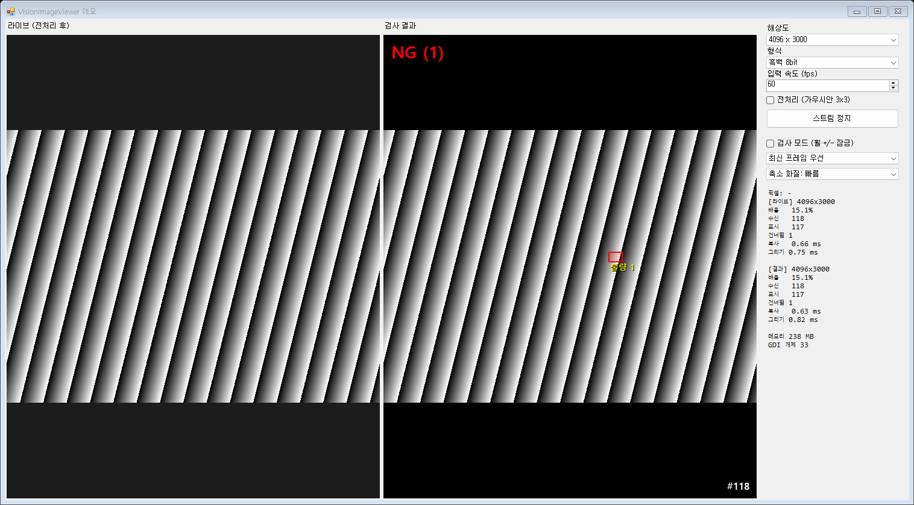

# VisionImageViewer

비전 프로젝트에서 이미지를 화면에 보여 줄 때 쓰는 WinForms 뷰어 컨트롤입니다.
카메라 벤더나 영상 라이브러리와 무관하게 쓸 수 있고, 고속으로 갱신되는 영상에서도 UI가 멈추거나 메모리가 늘지 않게 만들었습니다.



## 특징

- **외부 의존 없음** — 코어 DLL(약 50KB)은 .NET Framework만 참조합니다. 화면 출력은 GDI로 직접 합니다.
- **어떤 버퍼든 입력** — `IntPtr + 가로/세로/stride/픽셀포맷`으로 받습니다. Basler·Hikvision 버퍼, OpenCV Mat, MIL·HALCON·Cognex 이미지 모두 포인터만 꺼내 넘기면 됩니다.
- **스레드 안전** — `SetImage`는 카메라 스레드에서 바로 호출합니다. `Invoke`가 필요 없고, 화면이 그려질 때까지 기다리지 않습니다.
- **고속 갱신** — 프레임마다 메모리를 새로 잡지 않습니다. 입력이 화면보다 빠르면 최신 프레임으로 건너뛰되 마지막 프레임은 반드시 표시합니다.
- **확대/축소** — 마우스 휠, `+`/`-` 키, 우클릭 메뉴. 확대하면 스크롤바가 자동으로 생기고 드래그로 이동합니다.
- **검사 모드** — 운전 중 실수로 화면이 바뀌지 않도록 휠·키 확대를 잠급니다.
- **오버레이** — 불량 박스, 선, 글자, OK/NG 표시를 영상과 한 묶음으로 넘깁니다.
- **픽셀 포맷** — 흑백 8/10/12/16bit, BGR, RGB, BGRA, 평면 RGB.

## 빠른 시작

```csharp
using VisionImageViewer;

// 1) 만들기 — 배경색은 만들 때 정합니다
var viewer = new ImageViewer(new ImageViewerOptions { BackColor = Color.DimGray });
viewer.Dock = DockStyle.Fill;
Controls.Add(viewer);

// 2) 영상 넣기 — 어느 스레드에서든 호출 가능
viewer.SetImage(bufferPointer, width, height, stride, ViewerPixelFormat.Mono8);

// 3) 검사 결과와 함께 넣기
viewer.SetImage(bufferPointer, width, height, stride, ViewerPixelFormat.Mono8, new[]
{
    OverlayItem.Rect(new RectangleF(120, 80, 60, 40), Color.Red),
    OverlayItem.Label("NG", Color.Red)
});
```

OpenCvSharp를 쓰는 프로젝트는 어댑터 DLL을 함께 참조하면 Mat을 바로 넣을 수 있습니다.

```csharp
viewer.SetImage(mat);                    // CV_8UC1, CV_8UC3, CV_8UC4, CV_16UC1
OpenCvFileDecoder.Register();            // 16bit tif, webp 등도 열기 (프로그램 시작 시 한 번)
```

## 구성

| 폴더 | 내용 |
|---|---|
| `src/VisionImageViewer` | 코어 컨트롤. 외부 패키지 없음 |
| `src/VisionImageViewer.OpenCvSharp` | 선택 어댑터. `SetImage(Mat)`, OpenCV 파일 디코더 |
| `demo/VisionImageViewer.Demo` | 모의 카메라 → 전처리 → 라이브 뷰어 / 검사 → 결과 뷰어 |
| `tests/VisionImageViewer.Checks` | 검증 프로그램 (68항목), 성능 측정, 장시간 메모리 확인 |
| `docs` | 사용법, 구조, 성능, 타 라이브러리 연동 |

## 문서

- [사용법](docs/Usage.ko.md) — 설치, 영상 입력, 조작, 오버레이, 옵션 전체
- [구조](docs/Architecture.ko.md) — 프레임 흐름, 스레드 규칙, 그리기 방식과 그 이유
- [성능](docs/Performance.ko.md) — 측정 결과와 재측정 방법
- [타 라이브러리 연동](docs/Interop.ko.md) — OpenCvSharp, Basler, Hikvision, MIL, HALCON, Cognex 등
- [변경 이력](CHANGELOG.md)

## 요구 사항

- .NET Framework 4.7.2 이상, Windows
- Visual Studio 2022 (C# 7.3)
- 코어는 AnyCPU. 어댑터를 쓰면 OpenCvSharp4 4.13 계열과 x64

## 빌드와 검증

```bat
msbuild VisionImageViewer.sln -restore -p:Configuration=Release -p:Platform=x64
tests\VisionImageViewer.Checks\bin\Release\VisionImageViewer.Checks.exe
```

검증 프로그램은 실패가 있으면 종료 코드 1을 반환합니다. 실행 중 작은 창이 여러 번 떴다 사라집니다.

```bat
VisionImageViewer.Checks.exe bench          성능 측정 표 출력 (약 2분, 전체 화면 크기 창이 뜸)
VisionImageViewer.Checks.exe soak 1000000   100만 프레임 메모리·핸들 누수 확인
VisionImageViewer.Checks.exe stress 1000    여러 스레드 동시 입력 + 창 닫기 반복
```
