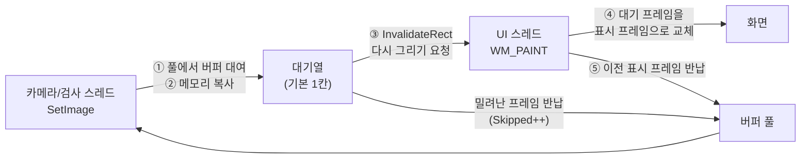

# 구조

## 파일 구성 (`src/VisionImageViewer`)

| 파일 | 역할 |
|---|---|
| `ImageViewer.cs` | 컨트롤 본체: 입력(`SetImage`), 대기열, 보기 상태, 수명 관리 |
| `ImageViewer.Render.cs` | 그리기: GDI 블릿, 배경, 격자·십자선·오버레이 |
| `ImageViewer.Input.cs` | 휠·키·드래그·우클릭 메뉴·끌어놓기 |
| `ImageViewer.Files.cs` | 파일 열기/저장, Bitmap 입력/캡처 |
| `FrameBuffer.cs`, `FramePool.cs` | 네이티브 메모리 프레임 버퍼와 재사용 풀 |
| `PixelConverter.cs` | 입력 버퍼 → 내부 보관 배치 복사 |
| `ViewTransform.cs` | 이미지↔화면 좌표 계산 (UI와 무관한 순수 계산) |
| `ImageFileCodec.cs` | GDI+ Bitmap 변환, 기본 파일 디코더 |
| `Overlay/OverlayItem.cs` | 오버레이 도형과 그리기 자원 캐시 |
| `NativeMethods.cs` | `StretchDIBits`, `InvalidateRect` 등 |

## 프레임 흐름

1. `SetImage`를 부른 스레드가 풀에서 버퍼를 빌려 영상을 복사합니다. 크기가 같으면 메모리를 다시 잡지 않습니다.
2. 대기열에 올립니다. 기본 정책(`LatestWins`)은 1칸이라, 아직 그려지지 않은 프레임이 있으면 그것을 풀에 돌려보내고 새 프레임으로 바꿉니다.
3. `InvalidateRect`로 다시 그리기를 요청하고 **즉시 돌아옵니다.** UI 스레드를 기다리지 않습니다.
4. UI 스레드가 `WM_PAINT`를 처리할 때 대기 프레임을 넘겨받아 그립니다.
5. 직전에 표시하던 프레임은 풀로 돌아가 다음 `SetImage`에 재사용됩니다.

정상 상태에서는 버퍼 3개(표시 중 / 대기 / 쓰는 중)가 계속 순환하므로 **프레임당 메모리 할당이 없습니다.**
오버레이를 함께 넘기면 그 목록을 떠 두는 작은 배열 하나만 생깁니다.

## 스레드 규칙

| 대상 | 접근 | 보호 방법 |
|---|---|---|
| 대기열, 통계, 해제 여부 | 모든 스레드 | `lock (_gate)` |
| 버퍼 풀 | 모든 스레드 | 풀 내부 `lock` |
| 표시 중 프레임(`_current`), 보기 상태(배율·스크롤) | UI 스레드만 | 규칙 (잠금 없음) |
| 창 핸들(`_hwnd`) | 모든 스레드에서 읽기 | `Volatile` |

- 프레임 버퍼는 한 시점에 한 곳만 소유합니다: 쓰는 스레드 → 대기열 → UI 스레드 → 풀.
- 표시 프레임 교체는 `OnPaint` 안에서만 일어나므로, UI 스레드의 `TryGetPixel`·`CaptureBitmap`이 읽는 도중에 버퍼가 바뀌지 않습니다.
- `Dispose` 뒤에 도착한 프레임은 대기열에 넣지 않고 바로 해제합니다. 카메라 스레드가 아직 돌고 있어도 안전합니다.
- 창 핸들이 파괴된 뒤의 `InvalidateRect`는 아무 일도 하지 않습니다.

## 왜 `BeginInvoke`가 아니라 `WM_PAINT`인가

프레임마다 `BeginInvoke`로 UI 스레드에 작업을 보내면 메시지 큐에 "게시된 메시지"가 쌓입니다.
Windows는 메시지를 **게시된 메시지 → 키·마우스 입력 → WM_PAINT → WM_TIMER** 순으로 꺼내므로,
프레임이 빠르게 들어오면 게시된 메시지에 밀려 사용자 입력이 처리되지 않아 화면이 멈춘 것처럼 보입니다.

`InvalidateRect`는 메시지를 쌓지 않고 "다시 그려야 함" 표시만 남깁니다. 몇 번을 부르든 `WM_PAINT`는 한 번이고,
입력보다 우선순위가 낮아 입력이 먼저 처리됩니다. 스레드 간 대리자 호출도 없어 프레임당 할당이 없습니다.

### 그리기 간격 규칙

`WM_PAINT`는 `WM_TIMER`보다 우선순위가 높습니다. 프레임이 쉬지 않고 들어와 그리기가 연속되면 타이머가 굶습니다.
(개발 중 실제로 확인: 4개 스레드가 쉬지 않고 프레임을 넣자 `Application.DoEvents()`가 반환하지 않았습니다.)

그래서 새 프레임을 그린 뒤에는 **그 그리기에 걸린 시간만큼(최소 1ms)** 다음 프레임 그리기를 요청하지 않습니다.
그 사이에 들어온 프레임은 대기열에서 최신 것으로 교체되고, 시간이 되면 타이머 한 번으로 그리기를 요청합니다.
UI 스레드는 최악의 경우에도 절반은 다른 일을 할 수 있습니다. `MaxDisplayFps`를 주면 그 간격도 함께 지킵니다.

## 그리기

`OptimizedDoubleBuffer`를 켠 상태에서 `OnPaint`가 다음 순서로 그립니다.

1. 영상이 덮지 않는 가장자리만 배경색으로 칠함
2. 영상 블릿 (GDI `StretchDIBits`)
3. 픽셀 격자, 십자선, 오버레이 (GDI+)
4. `Paint` 이벤트 (호스트가 추가로 그릴 수 있음)

영상은 두 가지 경로 중 하나로 그립니다.

| 경로 | 언제 | 방법 |
|---|---|---|
| 직접 | 8bit 흑백·32bit를 1:1 또는 확대 / `Smooth` 축소 | 프레임 버퍼에서 화면으로 바로. 보이는 줄부터 시작하는 주소와 보이는 줄 수만 GDI에 넘김 |
| 샘플링 | 24bit 컬러 / 16bit / `Fast` 축소 | 화면에 보이는 픽셀만 골라 화면 크기 버퍼(8bit 또는 32bit)에 담은 뒤 1:1로 그림 |

두 경로 모두 처리량이 **원본 크기가 아니라 화면 크기**에 비례합니다. 16384×4096 영상도 그리기 시간이 2~3ms입니다.

- 24bit를 샘플링하는 이유: GDI의 24bit→화면 변환이 느립니다(1080p에서 11~17ms 실측). 보이는 픽셀만 32bit로 바꾸면 3~4ms입니다.
- 흑백 8bit는 회색 팔레트 DIB로 넘겨 색 변환 없이 그립니다.
- 프레임 버퍼의 줄 간격을 GDI 규칙(4바이트 배수)에 맞춰 두어, 직접 경로에서 복사 없이 그릴 수 있습니다.
- 보이는 줄만 넘기는 방식은 `StretchDIBits`가 위→아래 영상의 일부를 그릴 때 세로 좌표를 다르게 해석하는 문제도 피합니다.

## 확대와 스크롤

- `ScrollableControl`의 `AutoScrollMinSize`에 확대된 영상 크기를 알려 주면 컨트롤보다 클 때 스크롤바가 자동으로 생깁니다.
- 마우스 위치 기준 확대: 마우스 아래의 이미지 지점을 구하고, 새 배율에서 그 지점이 같은 화면 위치에 오도록 스크롤 위치를 정합니다(`ViewTransform.ScrollForAnchor`).
- 같은 자리에서 휠을 연달아 굴릴 때는 처음 구한 이미지 지점을 그대로 씁니다. 매번 다시 구하면 스크롤 위치의 정수 반올림 오차가 쌓여 기준점이 밀립니다(10칸에 5px 실측 → 수정 후 1px 이내).
- 스크롤할 때는 화면 전체를 다시 그립니다. 배율이 정수가 아닐 때 기존 화면을 밀어 재사용하면 경계가 한 픽셀 어긋날 수 있기 때문입니다.

## 설계 결정 요약

| 결정 | 이유 |
|---|---|
| GDI 직접 렌더, 코어 외부 의존 없음 | OpenCV·MIL·HALCON·Cognex 어느 프로젝트에도 그대로 쓰기 위해 |
| 입력을 원시 버퍼로 | 모든 카메라 SDK·영상 라이브러리가 포인터와 줄 간격을 제공하므로 |
| 영상을 복사해서 보관 | 카메라 버퍼는 다음 프레임에 덮어써지므로. 복사는 호출 스레드에서 하므로 UI에 부담이 없음 |
| 네이티브 메모리 버퍼 풀 | 큰 프레임을 관리 힙에 반복 할당하면 대형 개체 힙이 조각나고 2세대 GC가 잦아짐 |
| Bitmap을 만들지 않음 | 프레임마다 GDI 핸들을 만들고 해제하는 비용과 누수 위험을 없앰 |
| 최신 프레임 우선 | 화면이 입력을 못 따라갈 때 지연이 쌓이지 않고, 마지막 프레임이 반드시 남음 |
